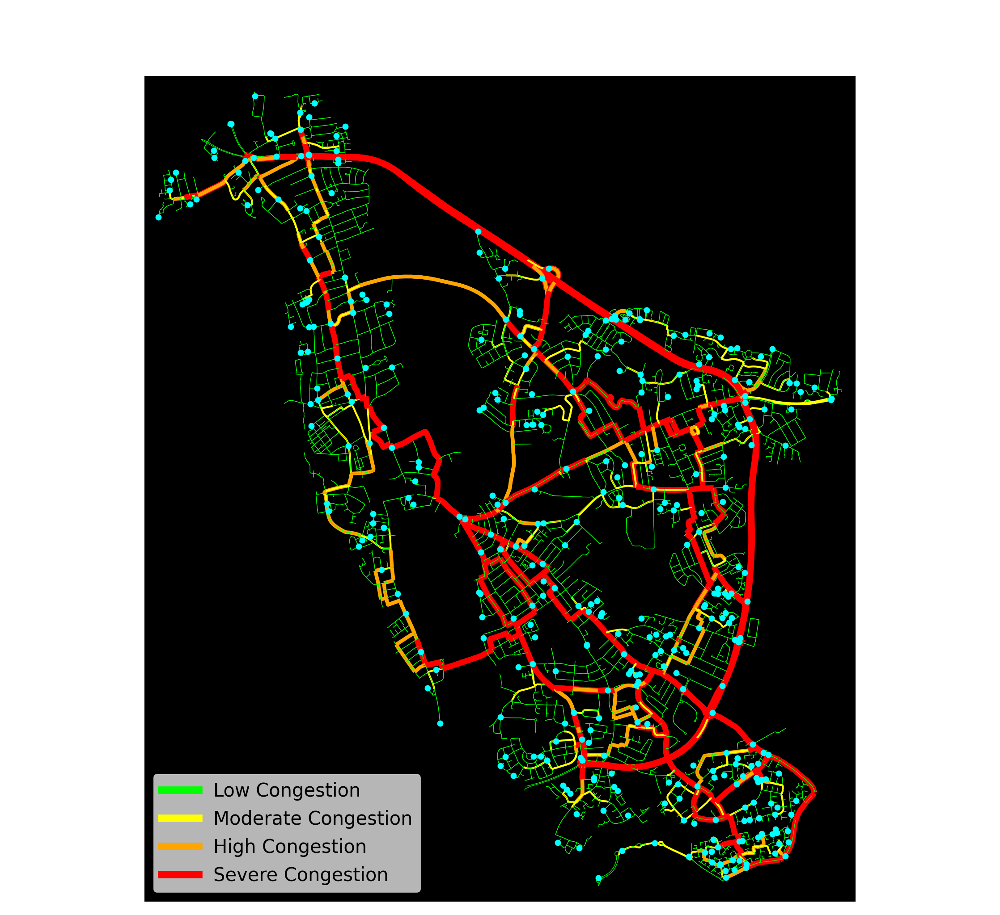
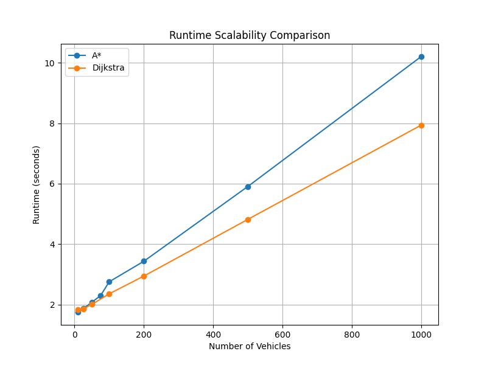
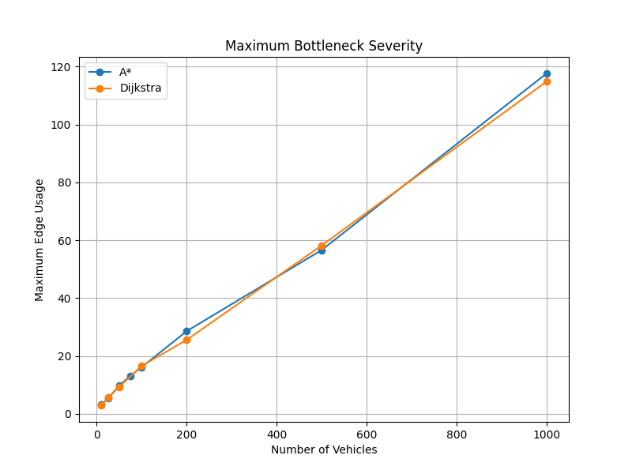
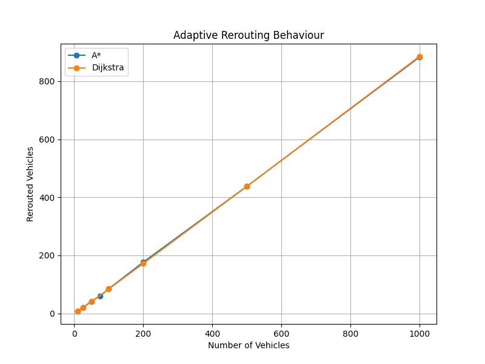
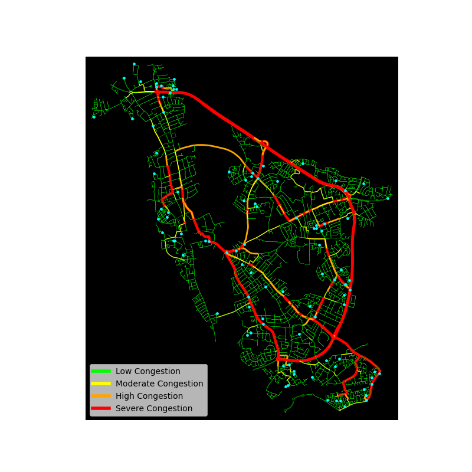
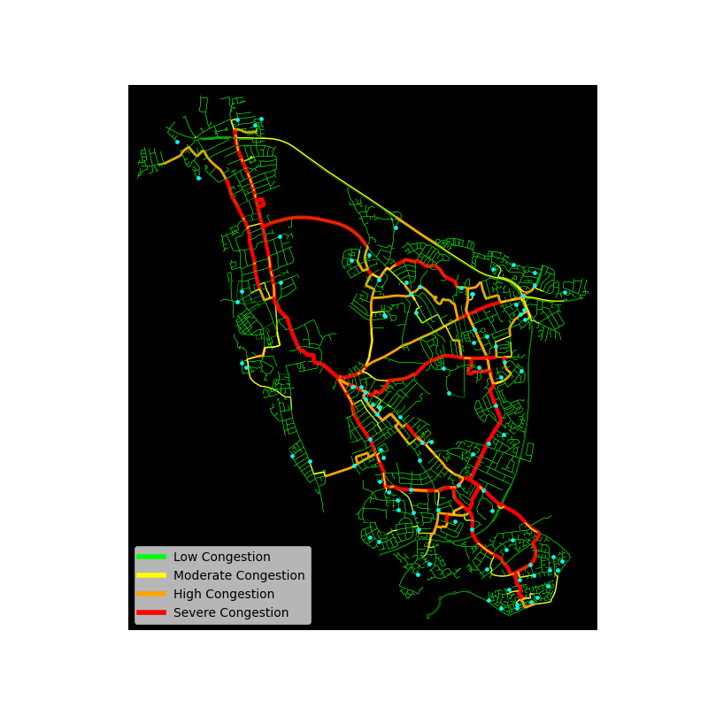
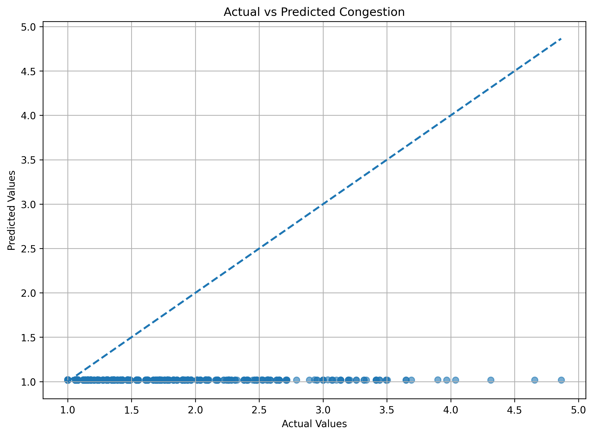

# Neural Traffic Routing and Congestion Optimisation System

<p align="center">
  
</p>

A simulation of congestion-aware routing on Oxford's real road network, built with Python, OSMnx and NetworkX, with a feed-forward neural network implemented from scratch in NumPy.

**📄 Full report:** [Congestion-Aware Adaptive Traffic Routing (PDF, revised November 2026)](report/Congestion_Aware_Traffic_Routing_Report.pdf). The LaTeX source is in [`report/`](report/).

---

# Overview

The system:

- builds Oxford's drivable road network from OpenStreetMap as a weighted directed graph (travel times in seconds)
- creates vehicles with random origins and destinations and routes them with **Dijkstra's algorithm** or **A\***
- counts how many vehicles use each road and increases the travel time of every used road in proportion to its usage
- re-routes every vehicle once on the updated travel times
- records metrics and before/after congestion heat-maps, and exports one training example per road
- trains a feed-forward neural network, written from scratch in NumPy, to predict each road's congestion multiplier

---

# Key Findings

| Question | Finding |
|---|---|
| Does A\* speed up routing? | **No.** The heuristic was straight-line distance in *degrees* while edge costs are *seconds*, so it gave almost no guidance. A\* took up to ~30% longer end to end than NetworkX's bidirectional Dijkstra. |
| Where does congestion build up? | **On a few corridors.** From 250 vehicles upwards, the busiest single road segment carried **11–13% of all vehicles**. |
| Does re-routing fix it? | **It moves congestion rather than removing it.** 82–91% of vehicles changed route, because each vehicle's own presence raises the cost of its route, and bottlenecks shifted to other corridors. |
| Can a neural network learn the congestion weighting? | **Not with the current training settings.** It predicts ≈1.02 for every road (test R² = −0.09), because the learning rate and weight initialisation were too small for the weights to move in 1,000 epochs. The report diagnoses this and sets out the fix. |

---

# Results

## Runtime

<p align="center"></p>

## Busiest road segment as traffic grows

<p align="center"></p>

## Vehicles re-routed

<p align="center"></p>

## Congestion before and after re-routing

<p align="center">
  
  
</p>

## Neural network: predicted vs actual multiplier

<p align="center"></p>

The full set of figures and their interpretation is in the [report](report/Congestion_Aware_Traffic_Routing_Report.pdf).

---

# How Congestion Is Modelled

After the initial routes are computed, each edge's usage $V_e$ is the number of routes that include it, and $\bar V$ is the mean usage over used edges. Every used edge's travel time becomes

$$
w_e = w_e^{\text{base}} \left(1 + 0.3325\,\frac{V_e}{\max(\bar V, 1)}\right)
$$

(the multiplier is capped at 4.8). It is always applied to the stored baseline travel time, so repeated updates cannot compound. Every vehicle is then re-routed once.

Heat-maps colour each road by $V_e / \bar V$: green below 0.5, yellow 0.5–1.0, orange 1.0–1.5, red 1.5 and above.

---

# Neural Network

```text
Input Layer (5 features)
        ↓
Hidden Layer 1 (16 neurons, ReLU)
        ↓
Hidden Layer 2 (8 neurons, ReLU)
        ↓
Output Layer (1 neuron, linear)
```

Forward propagation, back-propagation and gradient descent are implemented by hand in NumPy (`src/neural_network/neural_network.py`).

| Feature | Description |
|---|---|
| Edge usage | Number of vehicle routes using the edge |
| Road length | Length in metres |
| Speed limit | km/h (OSMnx, imputed where missing) |
| "Nearby congestion" | Edge usage × (length / 100) × (50 / speed). Despite the name, it uses only the edge's own values |
| Road type | Integer code, 0 (motorway) to 5 (residential) |

**Target:** the congestion multiplier $\min(1 + 0.35\,V_e/\max(\bar V,1),\ 5)$.
**Training:** full-batch gradient descent, learning rate 0.0001, 1,000 epochs, MSE loss, 80/20 train/test split.

---

# Project Structure

```text
Neural-Traffic-Routing-and-Congestion-Optimisation-System/
├── cache/                    # example heat-maps
├── report/                   # LaTeX source, figures and PDF of the report
├── research/
│   ├── experiments.md        # logged simulation runs
│   ├── ideas.md
│   └── research_log.md
├── results/
│   ├── figures/              # comparison plots
│   └── plots/                # neural-network plots
├── src/
│   ├── main.py               # simulation entry point
│   ├── cache/                # OSMnx download cache
│   ├── neural_network/       # network, training and inference
│   ├── routing/              # graph, vehicles, simulation, metrics
│   ├── utils/config.py       # settings and paths
│   └── visualisation/        # heat-maps and evaluation graphs
├── README.md
└── requirements.txt
```

Generated data (`results/data/`) and trained weights (`models/`) are created when the code runs and are not stored in the repository.

---

# Installation

Requires **Python 3.10–3.12**. The pinned `pandas==2.2.2` has no Python 3.13 build.

```bash
git clone https://github.com/vey-git/Neural-Traffic-Routing-and-Congestion-Optimisation-System.git
cd Neural-Traffic-Routing-and-Congestion-Optimisation-System

python -m venv .venv
source .venv/bin/activate        # Windows: .venv\Scripts\activate
pip install -r requirements.txt
```

---

# Running

The modules import each other relative to `src/`, so run them as follows.

**Run a simulation** (prompts for the number of vehicles and the algorithm). This needs an internet connection the first time, to download the Oxford road network:

```bash
cd src
python main.py
```

Each run appends a row to `results/data/processed/results_nn.csv` and training examples to `results/data/training/training_data.csv`.

**Train the neural network** (from the repository root, after running some simulations):

```bash
PYTHONPATH=src python -m src.neural_network.train_model
```

**Evaluation graphs:** `src/visualisation/evaluation_graphs.py` reads results with relative paths, so run it from inside `src/visualisation/`.

---

# Known Limitations

These are discussed in the report's *Threats to Validity* section:

- No random seed is fixed, so Dijkstra and A\* runs use different vehicles.
- Re-routing always uses Dijkstra's algorithm, whichever algorithm made the initial routes.
- `nodes_explored` records route length, not the number of nodes a search examined.
- Runtime includes graph loading, heat-map rendering and data export.
- `inference.py` loads `models/y_min.npy` relative to the working directory, so when the simulation runs from `src/` the trained model is not found and predictions fall back to 1.0.

---

# Next Steps

1. Fix the seed and re-route with the chosen algorithm, so the comparison is fair.
2. Use an admissible heuristic in seconds: great-circle distance ÷ maximum road speed.
3. Count settled nodes and time searches separately.
4. Retrain the network with He initialisation, a larger learning rate and mini-batches; compare against mean and linear-regression baselines.
5. Iterate re-routing towards an equilibrium, excluding each vehicle's own usage.
6. Measure edge betweenness centrality to test whether it predicts the persistent bottlenecks.

---

# Technologies

Python · NumPy · Pandas · Matplotlib · NetworkX · OSMnx · OpenStreetMap · LaTeX

---

# Author

Harvey Humphrey
BSc Computer Science with Artificial Intelligence
Oxford Brookes University
