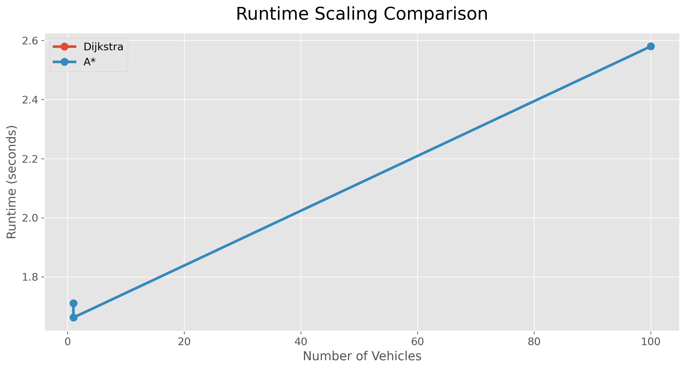
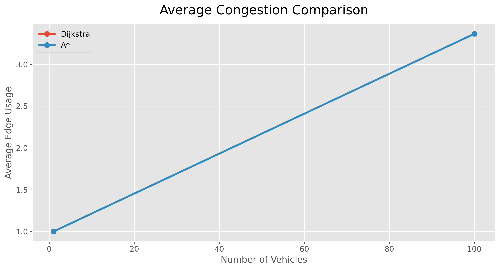
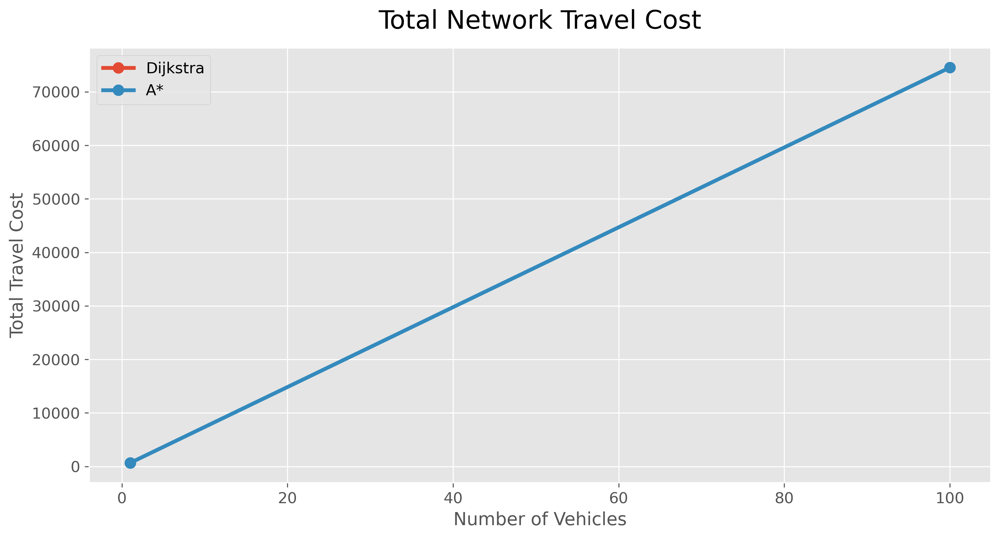
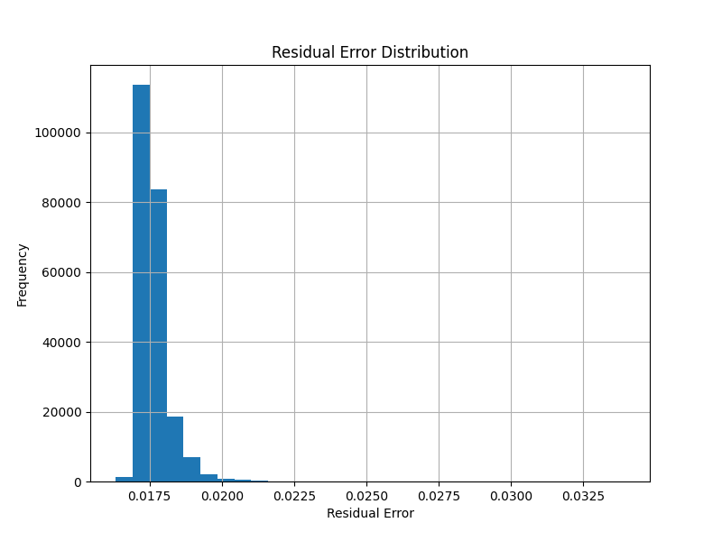

# Neural Traffic Routing and Congestion Optimisation System


An intelligent traffic-routing and congestion optimisation system built using:

- Python
- OSMnx
- NetworkX
- NumPy
- Machine Learning
- Adaptive Congestion Weighting

This project simulates large-scale vehicle routing across real-world urban road networks while dynamically adapting to congestion using both:
- classical shortest-path routing algorithms
- machine-learning-based congestion prediction

---

# Overview

This project investigates how adaptive congestion-aware routing can improve traffic flow across urban environments.

The system:
- generates real-world road graphs using OpenStreetMap
- simulates thousands of vehicles
- dynamically updates edge congestion
- reroutes vehicles using shortest-path algorithms
- evaluates routing efficiency through metrics and visualisations

A custom feed-forward neural network was implemented entirely from scratch using NumPy to learn adaptive congestion-weighting behaviour from generated traffic data.

---

# Key Features

## Real-World Road Network Simulation

Uses OpenStreetMap road data through OSMnx to generate:
- urban traffic graphs
- drivable road networks
- realistic edge travel times
- road metadata

---

## Intelligent Routing Algorithms

Implemented routing algorithms:

- Dijkstra’s Algorithm
- A* Search Algorithm

Vehicles dynamically reroute after congestion updates.

---

## Adaptive Congestion Modelling

Traffic congestion is estimated using:
- edge utilisation
- nearby congestion density
- road type
- road length
- speed limits

Edge weights are continuously updated to simulate evolving traffic conditions.

---

## Custom Neural Network

A fully connected feed-forward neural network built from scratch using NumPy.

Features include:
- forward propagation
- backpropagation
- ReLU activation
- regression output
- model persistence
- feature normalisation
- saved inference scaling

The network learns adaptive congestion-weighting behaviour from generated simulation data.

---

## Automated Visualisation System

Automatically generates:
- congestion heatmaps
- runtime scaling graphs
- congestion comparison graphs
- bottleneck analysis
- rerouting behaviour graphs
- neural-network evaluation plots

---

# Example Outputs

## Runtime Scaling Comparison



---

## Congestion Reduction Analysis



---

## Maximum Bottleneck Severity


---

## Adaptive Rerouting Behaviour


---

## Network Travel Cost



---

## Neural Network Training Loss


---

## Prediction Accuracy


---

## Residual Error Distribution



---

# Project Structure

```text
Neural-Traffic-Routing-and-Congestion-Optimisation-System/
│
├── assets/
├── cache/
├── docs/
│
├── models/
│   └── weights/
│       ├── W1.npy
│       ├── W2.npy
│       ├── W3.npy
│       ├── b1.npy
│       ├── b2.npy
│       ├── b3.npy
│       ├── X_mean.npy
│       └── X_std.npy
│
├── research/
│   ├── experiments.md
│   ├── ideas.md
│   └── research_log.md
│
├── results/
│   ├── actual_vs_predicted.png
│   ├── training_loss.png
│   │
│   ├── figures/
│   │   └── residual_histogram.png
│   │
│   ├── data/
│   │   ├── processed/
│   │   ├── raw/
│   │   └── training/
│   │
│   └── plots/
│       ├── heatmaps/
│       │   └── heatmap_astar_100.png
│       │
│       └── results/
│           ├── adaptive_rerouting_comparison.png
│           ├── average_congestion_comparison.png
│           ├── maximum_bottleneck_comparison.png
│           ├── runtime_comparison.png
│           └── total_travel_cost_comparison.png
│
├── src/
│   ├── neural_network/
│   │   ├── __init__.py
│   │   ├── inference.py
│   │   ├── neural_network.py
│   │   └── train_model.py
│   │
│   ├── routing/
│   │   ├── __init__.py
│   │   ├── graph.py
│   │   ├── metrics.py
│   │   ├── simulation.py
│   │   └── vehicle.py
│   │
│   ├── utils/
│   │   └── config.py
│   │
│   ├── visualisation/
│   │   ├── __init__.py
│   │   ├── evaluation_graphs.py
│   │   └── visualisation.py
│   │
│   ├── __init__.py
│   └── main.py
│
├── README.md
└── requirements.txt
```

---

# Neural Network Architecture

The congestion prediction model uses a fully connected feed-forward neural network:

```text
Input Layer (5 Features)
        ↓
Hidden Layer 1 (16 Neurons)
        ↓
Hidden Layer 2 (8 Neurons)
        ↓
Output Layer (1 Regression Output)
```

---

# Neural Network Input Features

| Feature | Description |
|---|---|
| Edge Usage | Number of vehicles using an edge |
| Road Length | Physical road length |
| Speed Limit | Road speed limit |
| Nearby Congestion | Local congestion estimate |
| Road Type | Encoded road classification |

---

# Simulation Workflow

## 1. Graph Generation

Road networks are generated from OpenStreetMap.

---

## 2. Vehicle Generation

Vehicles are assigned:
- random start nodes
- random destination nodes

---

## 3. Initial Routing

Vehicles compute shortest paths using:
- Dijkstra
or
- A*

---

## 4. Congestion Analysis

Edge usage is analysed across the network.

---

## 5. Adaptive Weighting

Travel times are dynamically updated using congestion weighting.

---

## 6. Vehicle Rerouting

Vehicles recompute routes using updated edge weights.

---

## 7. Evaluation

Performance metrics and visualisations are generated automatically.

---

# Evaluation Metrics

The system evaluates:

- Average Edge Usage
- Maximum Congestion Bottleneck
- Total Travel Cost
- Average Travel Cost
- Runtime Scaling
- Vehicle Rerouting Count
- Congestion Distribution
- Neural Network Prediction Error
- Residual Error Distribution

---

# Installation

## Clone Repository

```bash
git clone https://github.com/vey-git/Neural-Traffic-Routing-and-Congestion-Optimisation-System.git

cd Neural-Traffic-Routing-and-Congestion-Optimisation-System
```

---

## Create Virtual Environment

```bash
python -m venv .venv
```

---

## Activate Environment

### macOS / Linux

```bash
source .venv/bin/activate
```

### Windows

```bash
.venv\Scripts\activate
```

---

## Install Dependencies

```bash
pip install -r requirements.txt
```

---

# Running Simulations

## Run Main Simulation

```bash
python -m src.main
```

---

## Train Neural Network

```bash
python -m src.neural_network.train_model
```

---

## Generate Evaluation Graphs

```bash
python -m src.visualisation.visualisation
```

---

# Future Improvements

Planned future extensions include:

- Reinforcement learning routing
- Real-time traffic API integration
- GPU acceleration
- Distributed simulation
- Multi-agent traffic systems
- Live congestion forecasting
- Graph neural networks
- SUMO integration

---

# Technologies Used

- Python
- NumPy
- Pandas
- Matplotlib
- NetworkX
- OSMnx
- OpenStreetMap

---

# Author

Harvey  
Computer Science with Artificial Intelligence  
Oxford Brookes University
